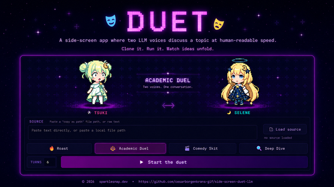

# Duet - Side-Screen LLM Dialogue

<p align="center">
  
</p>

```text
 /\_/\   /\_/\
( o.o ) ( -.- )   DUET
 > ^ <   > ^ <    one model, two voices, one shared thread
```

Duet is a compact Electron dashboard for a small secondary display beside your
main screen. Tsuki Hoshi and Selene Moonlight take turns analyzing a source with
one OpenAI-compatible model, while an optional local TTS endpoint can speak each
line as it appears.

The character layer keeps the panel lively. The useful work comes from the
selected mode, which gives each speaker a concrete role and keeps the dialogue
on task.

## What It Does

- **Loads a source:** paste raw text or a Windows "Copy as path" file reference.
  Text files become source material; image files can be sent to vision-capable
  models.
- **Runs two roles on one model:** Tsuki and Selene alternate over the same
  transcript so each answer can build on the previous one.
- **Offers focused modes:** Roast, Academic Duel, Comedy Skit, and Deep Dive.
- **Speaks when local TTS is available:** each character has a distinct voice
  prompt; without voice, Duet stays usable as text.
- **Waits between turns:** the next model call starts after the current text and
  optional audio finish.
- **Supports 18 languages:** one selector controls UI text, reply language, and
  the requested voice language.

## Requirements

- Node.js for Electron.
- An OpenAI-compatible chat endpoint:
  - LM Studio at `http://localhost:1234/v1`
  - Ollama at `http://localhost:11434/v1`
  - OpenRouter at `https://openrouter.ai/api/v1`
  - any compatible custom endpoint
- Optional local TTS server at `http://localhost:3113` with a
  WaifuVoice-compatible `/api/generate` endpoint for spoken dialogue.

For image sources, choose a vision-capable model. Local LM Studio, Ollama, and
local TTS runs keep source material on your machine. A cloud endpoint receives
the text or image content you submit and may cost money per call.

## Run

```bash
npm install
npm start
```

`npm start` opens the locked side-screen dashboard window. Press `Esc` to quit.

For development:

```bash
npm run dev
```

## Use

1. Start your LLM server or prepare an OpenRouter/custom key.
2. Start a compatible local TTS server if you want spoken dialogue.
3. Open settings and choose provider, model, temperature, API key if needed, and
   voice URL.
4. Paste a source, pick a mode, and start the exchange.

Modes:

- **Roast:** playful critique with useful fixes underneath the performance.
- **Academic Duel:** structured claims, counterclaims, evidence, and correction.
- **Comedy Skit:** lighter dialogue for ideation and explanation.
- **Deep Dive:** a grounded analysis loop that stays close to the source.

## Files And Privacy

Keep the app source, `locales/`, `i18n.js`, `TRANSLATION.md`, `assets/`, `souls/`,
`personas/`, `package-lock.json`, `LICENSE`, and this README together for a
standalone copy.

Git ignores generated local files such as `node_modules/`,
`displays-detected.json`, `.env*`, `*.local*`, secrets, keys, logs, caches, and
editor folders. Do not send private source material to a cloud provider unless
that is intentional.

## Credits

- **Concept, design, and development:** Cesar Borgenkrans / SparkleSnap.
- **Characters:** Tsuki Hoshi and Selene Moonlight.
- **Voice integration:** optional local TTS endpoint using the
  WaifuVoice-compatible JSON API shape.
- **Code co-author:** Claude Opus 4.8-senpai, and GPT-5.5-chan, AI pair
  programmers.
- **Part of:** [SparkleSnap](https://sparklesnap.dev) and
  [github.com/cesarborgenkrans-gif](https://github.com/cesarborgenkrans-gif).

## License And Creative Reuse

Copyright (c) 2026 Cesar Borgenkrans / SparkleSnap.

The source code in this project is released under the MIT License. See
[LICENSE](LICENSE). The MIT License applies to the code only.

The characters and creative world around this project are meant to be adored,
shared, and remixed. Fan art, fan fiction, small remixes, and other original fan
works are welcome with friendly credit to Cesar Borgenkrans / SparkleSnap.
SparkleSnap names, logos, official artwork files, visual identity, copy, fonts,
and other brand assets remain outside the code license. Please do not present
fan works as official releases or reuse SparkleSnap as your own brand.
Commercial use of characters, official artwork, or SparkleSnap branding needs
permission first.
